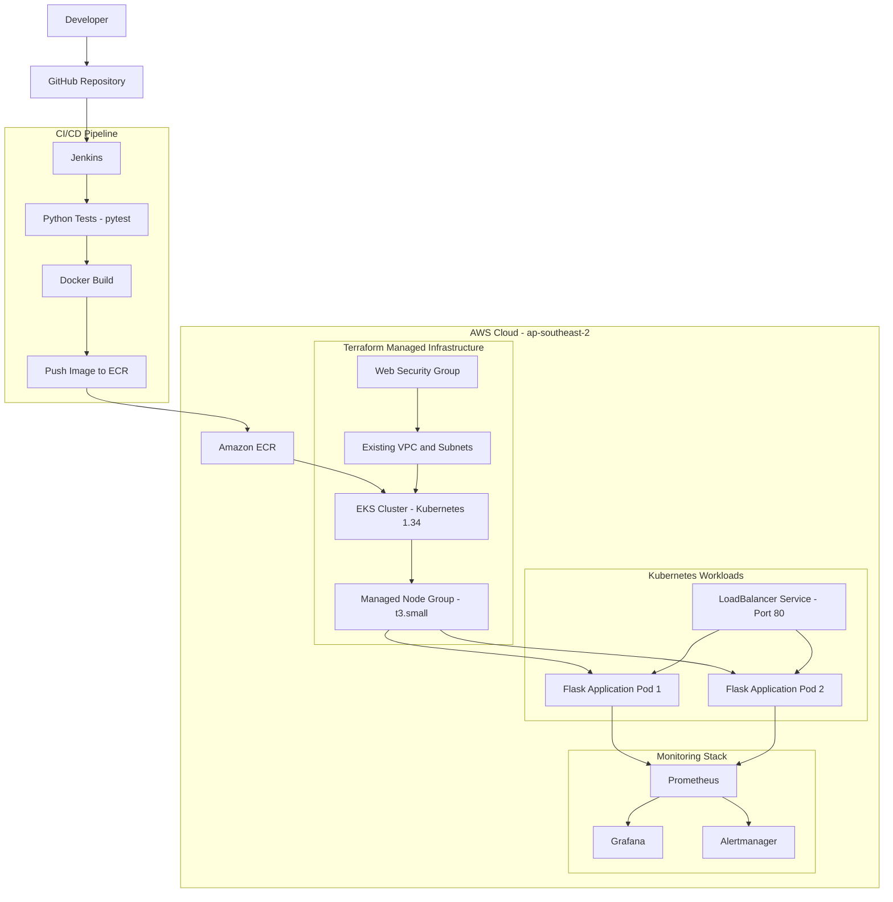

# End-to-End DevOps Capstone Project

An end-to-end DevOps CI/CD implementation using Jenkins, Docker, Amazon ECR, Terraform, Ansible, Kubernetes, Amazon EKS, Prometheus, Grafana and Alertmanager.

The project demonstrates application development, automated testing, containerization, infrastructure provisioning, continuous integration, continuous deployment, monitoring, self-healing and rollback.

---

## 1. Project Overview

The objective of this project is to implement an automated deployment pipeline for a Python Flask web application on AWS EKS.

The implementation covers:

- Source code management using Git and GitHub.
- Automated application testing using pytest.
- Docker image creation.
- Container image storage in Amazon ECR.
- AWS infrastructure management using Terraform.
- Linux configuration management using Ansible.
- CI/CD automation using Jenkins.
- Container orchestration using Kubernetes and Amazon EKS.
- External application access using Kubernetes LoadBalancer Service.
- Monitoring using Prometheus and Grafana.
- Alert management using Alertmanager.
- Application availability testing and deployment rollback.

## 2. Architecture Diagram



### Infrastructure and application flow

1. Developer pushes application changes to GitHub.
2. Jenkins checks out the source code.
3. Jenkins creates a Python virtual environment and executes pytest.
4. Jenkins builds the Docker image.
5. Jenkins authenticates with Amazon ECR and pushes the image.
6. Jenkins updates the Kubernetes deployment on Amazon EKS.
7. Kubernetes manages application replicas.
8. AWS LoadBalancer exposes the application externally.
9. Prometheus collects Kubernetes and application-related metrics.
10. Grafana visualizes monitoring data.
11. Alertmanager receives alerts from Prometheus.
12. Jenkins performs automatic rollback when a deployment rollout fails.

## 3. Technology Stack

| Category | Technology |
|---|---|
| Application | Python, Flask |
| Testing | pytest |
| Source Control | Git, GitHub |
| Containerization | Docker |
| Container Registry | Amazon ECR |
| CI/CD | Jenkins |
| Infrastructure as Code | Terraform |
| Configuration Management | Ansible |
| Cloud Platform | AWS |
| Container Orchestration | Kubernetes, Amazon EKS |
| Monitoring | Prometheus |
| Visualization | Grafana |
| Alert Management | Alertmanager |
| Metrics | Node Exporter, kube-state-metrics |
| Operating System | Ubuntu 26.04.1 LTS |

## 4. Project Environment

| Component | Configuration |
|---|---|
| AWS Region | ap-southeast-2 |
| EKS Cluster | capstone-eks |
| Kubernetes Version | 1.34 |
| Node Instance Type | t3.small |
| Desired Worker Nodes | 2 |
| Minimum Worker Nodes | 1 |
| Maximum Worker Nodes | 3 |
| ECR Repository | devops-capstone-web |
| Application Deployment | devops-capstone-app |
| Kubernetes Service | devops-capstone-service |
| Application Port | 5000 |
| External Service Port | 80 |

## 5. Project Directory Structure

```text
my-devops-capstone/
│
├── app.py
├── requirements.txt
├── Dockerfile
├── .dockerignore
├── .gitignore
├── Jenkinsfile
├── README.md
│
├── tests/
│   └── test_app.py
│
├── ansible/
│   ├── ansible.cfg
│   ├── inventory/
│   │   └── hosts.ini
│   └── playbooks/
│       └── server_setup.yml
│
├── terraform/
│   ├── main.tf
│   ├── providers.tf
│   ├── variables.tf
│   ├── outputs.tf
│   └── modules/
│       ├── network-info/
│       ├── web-security/
│       └── eks/
│
├── k8s/
│   ├── deployment.yaml
│   ├── service.yaml
│   └── prometheus-alerts.yaml
│
└── snapshots/
    ├── 02-github-app-tests/
    ├── 03-docker-ecr/
    ├── 04-jenkins/
    ├── 05-terraform-aws/
    ├── 06-ansible/
    ├── 07-eks-kubernetes/
    ├── 08-loadbalancer-health/
    ├── 09-jenkins-eks-cicd/
    ├── 10-monitoring-alerts/
    └── 11-testing-rollback/
```

## 6. Application Details

The project uses a Python Flask application.

### Application endpoints

| Endpoint | Method | Description |
|---|---|---|
| `/` | GET | Returns application information |
| `/health` | GET | Returns application health status |

Example application response:

```json
{
  "application": "DevOps Capstone Web App",
  "status": "running",
  "version": "1.0.1"
}
```

Health response:

```json
{
  "status": "healthy"
}
```

### Python dependencies

- Flask 3.1.0
- pytest 8.3.4

## 7. Docker Implementation

The Dockerfile uses `python:3.14-slim` as the base image.

Implementation steps:

1. Pull the Python slim base image.
2. Configure `/app` as the working directory.
3. Install Python dependencies.
4. Copy the Flask application.
5. Expose port 5000.
6. Start the Flask application.

Build and run locally:

```bash
docker build -t devops-capstone-web:local .
docker run -d -p 5000:5000 --name devops-capstone-app devops-capstone-web:local
```

Test the application:

```bash
curl http://localhost:5000/
curl http://localhost:5000/health
```

## 8. Terraform Infrastructure Provisioning

Terraform is used to manage AWS infrastructure.

### Terraform modules

**Network Info Module**
- References an existing AWS VPC.
- Discovers existing subnets.
- Discovers existing security groups.
- Exposes network information through outputs.

**Web Security Module**
- Creates a Terraform-managed web security group.
- Allows HTTP traffic on port 80.
- Allows HTTPS traffic on port 443.

**EKS Module**
- Creates the Amazon EKS cluster.
- Configures public and private API endpoints.
- Configures Kubernetes subnet tags.
- Creates an EKS managed node group.

### EKS configuration

- Cluster: `capstone-eks`
- Kubernetes version: `1.34`
- Instance type: `t3.small`
- Desired nodes: 2
- Minimum nodes: 1
- Maximum nodes: 3

### Terraform commands

Run from the Terraform directory:

```bash
cd terraform
terraform init
terraform validate
terraform plan
terraform apply
```

Note: Supply the required existing VPC ID through your local Terraform variables. Review the execution plan before applying infrastructure changes.

## 9. Ansible Configuration Management

Ansible is used to automate basic Linux server configuration.

### Implementation

- Installed Ansible Core 2.20.1.
- Configured Ansible inventory.
- Validated connectivity using the ping module.
- Created a server configuration playbook.
- Ensured curl was installed.
- Created `/opt/devops-capstone`.
- Created an Ansible-managed configuration file.
- Validated playbook syntax.
- Executed a dry run using check mode and diff.
- Executed the playbook successfully.
- Verified idempotency.

### Ansible validation

```bash
ANSIBLE_CONFIG=ansible/ansible.cfg ansible-inventory --graph

ANSIBLE_CONFIG=ansible/ansible.cfg ansible-playbook ansible/playbooks/server_setup.yml
```

The second playbook execution returned:

```text
ok=5
changed=0
unreachable=0
failed=0
```

Scope: This implementation uses a local connection on the EC2 controller instance. Remote SSH management of separate EC2 instances has not been implemented.

## 10. Jenkins CI/CD Pipeline

Jenkins automates the application delivery process.

### Pipeline stages

1. Checkout
2. Test
3. Build Docker Image
4. Deploy to EKS

### Pipeline implementation

**Checkout**
- Retrieves source code from GitHub.

**Test**
- Creates a Python virtual environment.
- Installs application dependencies.
- Runs pytest.

**Build Docker Image**
- Builds the Docker image.
- Uses Jenkins build number as the image tag.

**Push to Amazon ECR**
- Authenticates with AWS.
- Tags the Docker image.
- Pushes the image to Amazon ECR.

**Deploy to EKS**
- Configures EKS access.
- Reads the currently deployed image.
- Updates the Kubernetes deployment.
- Waits for rollout completion.
- Verifies deployment and pod status.

### Automatic rollback

The Jenkins pipeline includes a `ROLLBACK_TEST` parameter.

When enabled:
- An intentionally invalid image is deployed.
- Kubernetes rollout is expected to fail.
- Jenkins triggers `kubectl rollout undo`.
- Jenkins waits for rollback completion.
- The restored image is compared with the previous image.
- The rollback test succeeds only after image restoration is verified.

## 11. Kubernetes Deployment

The Flask application runs on Amazon EKS.

### Deployment configuration

- Deployment name: `devops-capstone-app`
- Desired replicas: 2
- Container port: 5000
- Container image: Amazon ECR

### Health probes

**Readiness Probe**
- Checks `/health`.
- Initial delay: 5 seconds.
- Period: 10 seconds.

**Liveness Probe**
- Checks `/health`.
- Initial delay: 15 seconds.
- Period: 20 seconds.

### Kubernetes Service

- Service name: `devops-capstone-service`
- Service type: `LoadBalancer`
- External port: 80
- Target port: 5000

Application traffic flow:

```text
Internet
   |
AWS LoadBalancer
   |
Kubernetes Service :80
   |
Application Pods :5000
   |
Flask Application
```

## 12. Monitoring and Alerting

The monitoring stack uses kube-prometheus-stack installed through Helm.

### Monitoring components

| Component | Purpose |
|---|---|
| Prometheus | Metrics collection |
| Grafana | Dashboards and visualization |
| Alertmanager | Alert management |
| Node Exporter | Node-level metrics |
| kube-state-metrics | Kubernetes resource metrics |

### Custom Prometheus alerts

| Alert | Severity | Description |
|---|---|---|
| DevOpsCapstoneAppReplicasUnavailable | Critical | Detects unavailable application replicas |
| DevOpsCapstoneAppContainerRestart | Warning | Detects application container restarts |
| DevOpsCapstoneAppPodNotReady | Warning | Detects pods remaining not ready |

### Monitoring validation

- Verified Grafana cluster dashboards.
- Monitored CPU and memory metrics.
- Verified application pod metrics.
- Verified Prometheus targets.
- Verified custom alert rules.
- Verified Prometheus-to-Alertmanager connectivity.
- Sent a temporary test alert and confirmed receipt.

Note: External email, Slack and SNS notification delivery has not been configured.

## 13. Testing and Rollback

The following scenarios were successfully validated.

### Application health

- Verified two available application replicas.
- Verified both pods were Running.
- Verified public health endpoint returned HTTP 200.

### Kubernetes self-healing

- Intentionally deleted one application pod.
- Kubernetes automatically created a replacement pod.
- Verified both replicas returned to Ready state.
- Application remained available.

### Deployment rollback

- Inspected Kubernetes rollout history.
- Rolled back from image tag 24 to image tag 22.
- Verified successful rollout.
- Restored image tag 24.
- Verified both replicas were available.
- Verified public health endpoint returned HTTP 200.

### Final tested deployment state

| Configuration | Result |
|---|---|
| Image tag | 24 |
| Desired replicas | 2 |
| Available replicas | 2 |
| Pod status | Running |
| Health endpoint | HTTP 200 |

## 14. Security Considerations

- Terraform state files are excluded from Git tracking.
- Terraform variable files are excluded from Git tracking.
- Terraform plan files are excluded from Git tracking.
- Python virtual environments are excluded from Git tracking.
- Jenkins local backup files are excluded from Git tracking.
- EKS public API access is restricted to `16.176.131.138/32`.
- EKS public and private API endpoints are enabled.

### Security improvements to consider

- Restrict HTTP and HTTPS ingress to the required source ranges where appropriate.
- Configure HTTPS with a valid TLS certificate.
- Use least-privilege IAM roles for Jenkins and EKS.
- Store application secrets in AWS Secrets Manager or an equivalent secure service.
- Configure external alert notifications.
- Enable Terraform remote state storage and state locking for collaborative environments.

Note: The Terraform-managed web security group currently allows HTTP and HTTPS from `0.0.0.0/0`. Review this exposure before production use.

## 15. Project Evidence

Screenshots and validation evidence are maintained under the `snapshots/` directory.

| Phase | Evidence |
|---|---|
| GitHub and App Tests | `snapshots/02-github-app-tests/` |
| Docker and ECR | `snapshots/03-docker-ecr/` |
| Jenkins | `snapshots/04-jenkins/` |
| Terraform and AWS | `snapshots/05-terraform-aws/` |
| Ansible | `snapshots/06-ansible/` |
| EKS and Kubernetes | `snapshots/07-eks-kubernetes/` |
| LoadBalancer Health | `snapshots/08-loadbalancer-health/` |
| Jenkins and EKS CI/CD | `snapshots/09-jenkins-eks-cicd/` |
| Monitoring and Alerts | `snapshots/10-monitoring-alerts/` |
| Testing and Rollback | `snapshots/11-testing-rollback/` |

## 16. Cleanup and Cost Management

AWS resources such as EKS clusters, EC2 worker nodes, LoadBalancers, ECR images and monitoring infrastructure may incur charges.

Before destroying resources:

1. Review running AWS resources.
2. Check Terraform state and dependency relationships.
3. Review the Terraform destroy plan.
4. Confirm that resources are no longer required.
5. Back up any required application data and evidence.

Use Terraform destroy only after reviewing its impact.

```bash
cd terraform
terraform plan -destroy
```

Do not destroy shared or pre-existing infrastructure without verifying ownership and dependencies.

## 17. Project Outcome

This project demonstrates an end-to-end DevOps workflow covering:

- Application development and automated testing.
- Docker containerization.
- AWS container image management.
- Infrastructure provisioning with Terraform.
- Linux configuration management with Ansible.
- Jenkins-based CI/CD automation.
- Kubernetes application deployment.
- AWS EKS orchestration.
- Monitoring and alerting.
- Kubernetes self-healing.
- Automated and manual rollback validation.

The implementation provides practical experience with AWS cloud infrastructure, container orchestration, automation, deployment reliability and monitoring.

---

**Project:** DevOps Capstone CI/CD

**GitHub Repository:** https://github.com/sahbu90/devops-capstone-cicd
